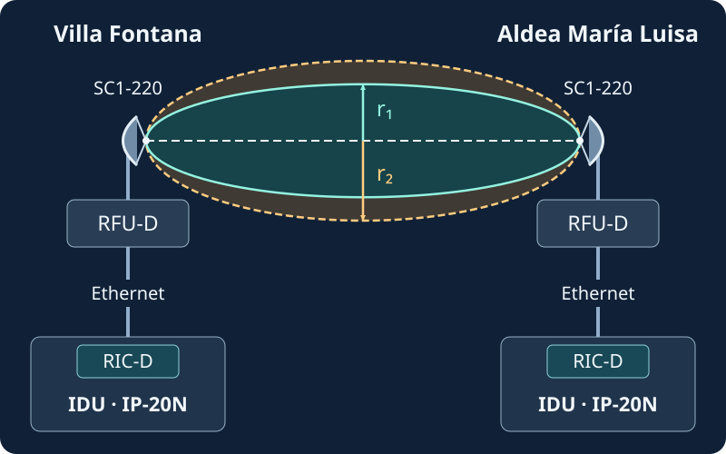

# Microwave radio link design

[Español](README.md) · [English](README.en.md)

**Nicolás Fontana and Juan Andrés Terlin** · Microwave Equipment · Electronic Engineering, UTN Facultad Regional Paraná · 2026.

## Problem and objectives

Can a **5.88 km** hop carry **155 Mbit/s** between Villa Fontana and Aldea María Luisa with trees along the path? The project investigates antenna mounting heights, the modulation needed for the target throughput and the margin available for propagation losses. The authors visited the sites. Received power, fade margin and availability are design estimates.

## Design summary

The proposed system uses a Ceragon IP-20N with a RIC-D interface, RFU-D and 0.30 m RFS SC1-220 antenna at each end. The authors combined an IGN map, Google Earth and spreadsheet calculations to compare terrain clearance at two effective Earth radii. The 28 MHz channel arrangement follows ITU-R F.637-5. The link budget assumes 128-QAM and 35.5 dBi per antenna.

The analytical case yields −41.72 dBm received power and 27.78 dB fade margin. The final worksheet includes 6.02 dB of obstruction loss and yields −47.68 dBm and 21.82 dB. The adopted profile and the appendix use different path lengths. Final clearance, the direct-mount kit and the 99.99% availability target remain open engineering questions.

## Technical documentation (Spanish)

- [Field survey and path profile](docs/01-relevamiento-y-perfil.md)
- [Propagation and Fresnel clearance](docs/02-propagacion-y-fresnel.md)
- [RF equipment and architecture](docs/03-equipamiento-rf.md)
- [Frequency plan and throughput](docs/04-plan-de-frecuencias.md)
- [RF link budget](docs/05-presupuesto-rf.md)
- [Availability estimates](docs/06-disponibilidad.md)
- [Proposed installation](docs/07-instalacion-propuesta.md)
- [Conclusions and references](docs/08-conclusiones-y-referencias.md)
- [Technical review and open questions](docs/revision-tecnica.md)
