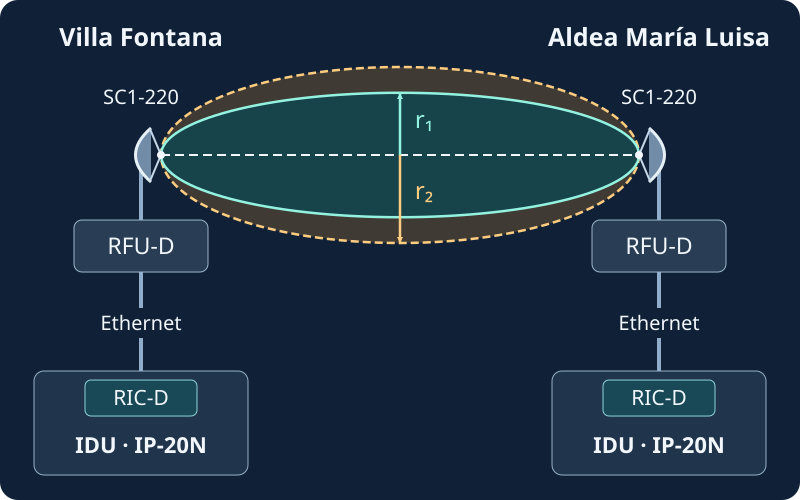

# Diseño de un radioenlace digital de microondas

[Español](README.md) · [English](README.en.md)

**Nicolás Fontana y Juan Andrés Terlin** · Equipos de Microondas · Ingeniería Electrónica, UTN Facultad Regional Paraná · 2026.

## Problema y objetivos

¿Puede un salto de **5,88 km** transportar **155 Mbit/s** entre Villa Fontana y Aldea María Luisa con arboledas en el trayecto? El proyecto estudia dónde ubicar las antenas en altura, qué modulación satisface la capacidad requerida y cuánto margen queda frente a las pérdidas de propagación. Los autores reconocieron físicamente los emplazamientos. Las potencias, los márgenes y la disponibilidad proceden de modelos de diseño.

## Resumen del diseño

En cada extremo se propone una Ceragon IP-20N con interfaz RIC-D, RFU-D y antena RFS SC1-220 de 0,30 m. Se combinaron cartografía del IGN, Google Earth y cálculos en planilla para comparar el despejamiento con dos radios terrestres efectivos. La canalización de 28 MHz sigue UIT-R F.637-5. El presupuesto adopta 128-QAM y 35,5 dBi por antena.

El cálculo analítico arroja −41,72 dBm en recepción y 27,78 dB de margen. La plantilla final incorpora 6,02 dB por obstrucción y obtiene −47,68 dBm y 21,82 dB. El perfil adoptado y el anexo usan distancias diferentes. Quedan abiertos el despejamiento definitivo, el kit de montaje directo y la verificación del objetivo de disponibilidad de 99,99 %.

## Documentación técnica

- [Relevamiento y perfil del trayecto](docs/01-relevamiento-y-perfil.md)
- [Propagación, curvatura y zonas de Fresnel](docs/02-propagacion-y-fresnel.md)
- [Equipamiento y arquitectura de comunicaciones](docs/03-equipamiento-rf.md)
- [Plan de frecuencias y capacidad](docs/04-plan-de-frecuencias.md)
- [Presupuesto de potencia radioeléctrica](docs/05-presupuesto-rf.md)
- [Desvanecimiento y disponibilidad estimada](docs/06-disponibilidad.md)
- [Instalación propuesta e interconexión](docs/07-instalacion-propuesta.md)
- [Conclusiones y referencias](docs/08-conclusiones-y-referencias.md)
- [Revisión técnica del informe académico](docs/revision-tecnica.md)
