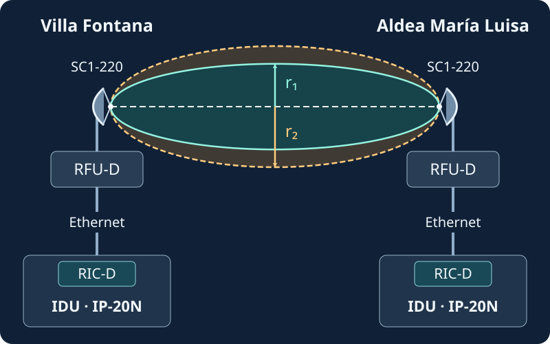

# Equipamiento y arquitectura de comunicaciones

| Elemento seleccionado | Función | Condición de diseño |
|---|---|---|
| Ceragon FibeAir IP-20N y tarjeta RIC-D | Interfaz de tráfico interior y enlace digital hacia la radio exterior | Configuración de un salto con una portadora por sentido |
| Ceragon RFU-D | Modulación y conversión radioeléctrica en el exterior | Confirmar variantes alta y baja que cubran el par dúplex |
| RFS SC1-220 | Antena de 0,30 m, polarización horizontal adoptada | El balance emplea 35,5 dBi por extremo |
| Adaptador de montaje | Acoplamiento entre antena y radio | Verificar sufijo de antena, interfaz, orientación y kit |

El diseño supone montaje directo y asigna 0 dB al alimentador RF. El informe cita una pérdida de 0,1 dB para ciertos adaptadores. Debe incorporarse por extremo si se confirma que corresponde al conjunto elegido. La RFU-D abarca distintas variantes dentro de la familia de 6–42 GHz. La cobertura de una unidad depende de su referencia.

Con la RIC-D la interconexión es digital. La arquitectura alternativa con tarjeta RMC y frecuencia intermedia por coaxial tiene pérdidas y conexiones diferentes. El esquema de montaje 2+0 con circulador que figura en el anexo corresponde a otra configuración.

Fuente primaria: TP, pp. 34–38 y 43–51. [Interconexión e instalación](07-instalacion-propuesta.md).
