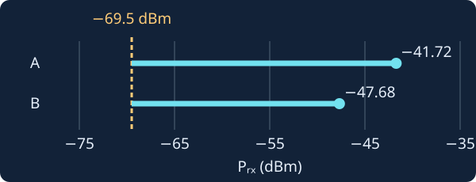

# Presupuesto de potencia radioeléctrica

La pérdida de espacio libre para distancia en km y frecuencia en GHz es

$$L_{fs}=92{,}45+20\log_{10}(D_{km})+20\log_{10}(f_{GHz}).$$

La potencia recibida y el margen sobre el umbral se calculan como $P_r=P_t+G_t+G_r-L_{total}$ y $M=P_r-S_{rx}$. Los niveles absolutos se expresan en dBm y su diferencia en dB. Se utilizan 22 dBm, dos antenas de 35,5 dBi y un umbral de −69,5 dBm.

| Término | Analítico, p. 19 | Plantilla, p. 22 |
|---|---:|---:|
| Espacio libre | 134,72 dB | 134,67 dB |
| Obstrucción aplicada | 0 dB | 6,02 dB |
| Pérdida total publicada | 134,72 dB | 140,68 dB |
| Potencia recibida | −41,72 dBm | −47,68 dBm |
| Margen | 27,78 dB | 21,82 dB |

Con 5,88 km y 22,078 GHz se reproducen 134,72 dB y −41,72 dBm. Para la plantilla se reproduce $22+2(35{,}5)-140{,}68=-47{,}68$ dBm. Las pérdidas parciales visibles suman 140,69 dB, diferencia de 0,01 dB respecto al total mostrado. La plantilla ubica un obstáculo a 0,30 km. La tabla 4 ubica el primero a 0,03 km. Su equivalencia física queda pendiente.

**Lluvia.** Para polarización horizontal el desarrollo utiliza $R_{0.01}=42$ mm/h, $k_R=0{,}1155$ y $\alpha=1{,}0329$. La atenuación específica $\gamma_R=k_R R^{\alpha}$ es aproximadamente 5,48 dB/km. El procedimiento del TP adopta $d_0=35\exp(-0{,}015R)$ km y $d_{ef}=D/(1+D/d_0)$, unos 4,47 km. Así obtiene $A_{0.01}\approx24{,}46$ dB. Es una atenuación excedida durante el 0,01 % del tiempo según el modelo. Frente a esa atenuación quedarían 3,32 dB del margen analítico. Compararla con el segundo balance exige primero unificar coeficientes y obstrucción.

Fuente primaria: TP, pp. 19–22. [Modelo de atenuación específica UIT-R P.838-3](https://www.itu.int/rec/R-REC-P.838-3-200503-I/en).
